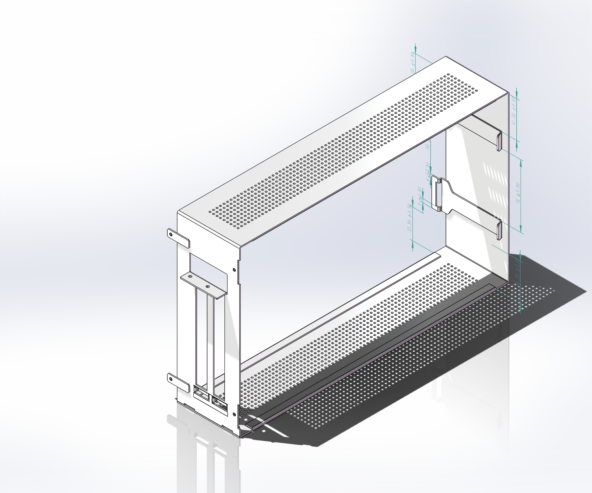

# 模块化机箱 · 焊接固定版

本项目记录一款可由两个相同单体拼装的钣金机箱设计，包括可编辑的 SOLIDWORKS 三维模型、单箱与双箱装配、工程图，以及插榫、侧板和焊接结构的研究过程。

Welded modular sheet-metal chassis: editable SOLIDWORKS models, assemblies, manufacturing drawings, and design research.



## 从哪里开始

- 查看整机：打开 [单箱含侧板装配](生产图纸%20焊接固定/全焊_单箱含侧板_草图可编辑.SLDASM)。
- 查看双箱组合：打开 [相同双箱含侧板装配](生产图纸%20焊接固定/全焊_相同双箱含侧板_草图可编辑.SLDASM)。
- 浏览工程图：[主体及安装件，8页 PDF](生产图纸%20焊接固定/全焊_生产尺寸与制造要求.pdf)、[侧板，7页 PDF](生产图纸%20焊接固定/配套侧板/全焊_侧板_X压印深1_尺寸与制造要求.pdf)。
- 了解设计：[设计决策](docs/design-decisions.md)、[尺寸与接口](docs/dimensions-and-interfaces.md)、[制造与核验状态](docs/manufacturing-and-verification.md)。
- 查找具体零件：[文件与装配关系](docs/file-guide.md)。

## 当前设计

| 项目 | 当前名义设计 |
| --- | --- |
| 箱体基体，长×宽×高 | 308 × 71.2 × 189 mm |
| 侧盖板覆盖范围 / 板厚 | 308 × 189 mm / 1.2 mm |
| 前插榫头宽 / 舌宽 / 舌端圆角 | 32 / 16 mm / R2 |
| 前插榫自身长槽 | 24 mm，上下边栏各4 mm |
| 两片插榫安装中线 | Y50.5 / Y138.5，中心距88 mm |
| 侧板前卡耳槽 | 18 × 5 mm，配16 mm舌片 |
| 侧板后安装耳 | 侧板同料一体90°折弯，M3×0.5-6H |
| 后孔中心至侧板内贴合面 | 6 mm |
| 背板折弯避让 | 保留上下两处2 × 24 mm缺口 |
| 侧板加强 / 散热 | 向箱内深1 mm的X形浅压印，1522个Ø2网孔，中部21 mm无孔横带 |
| 表面处理 | 校平（压直）、磨砂、钛灰色喷漆 |
| 一般尺寸要求 | ±0.5 mm；未注边角R0.5；M3螺纹按6H |

24 mm是**前插榫片自身槽口**的尺寸；18 × 5 mm是**侧板前卡耳槽**的尺寸；背板的2 × 24 mm是另一组折弯避让缺口。三者位置和作用不同，修改时应分别核对。

## 文件范围与状态

`生产图纸 焊接固定/`只保存一套当前焊接版：5个零件、5个装配、2份工程图、2份PDF和1份原始说明，共15个文件。螺栓版、铆接版、历史试画模型及重复压缩包均不纳入本仓库。

模型保留原生草图和特征，可以手工修改；部分草图欠约束，装配也未建立完整的参数联动。现有模型不是可以直接输出全部下料展开的钣金工艺树。

槽24修订时，记录显示四套相关装配静态实体干涉均为0，前插榫实体与特征检查通过，重开后槽宽和草图保留。图纸审核仍存在展开资料、局部标注、基准、公差叠加及实物工艺验证等待确认项。**本仓库是设计研究与图纸基线归档，未宣称已经完成制造放行。** 逐项状态见[制造与核验说明](docs/manufacturing-and-verification.md)。

## 下载与编辑

1. 使用 Git 克隆，或在 GitHub 的 **Code → Download ZIP** 下载整个仓库。
2. 保留`生产图纸 焊接固定/配套侧板/`的相对位置，不要只下载单个装配文件。
3. 原文件使用 SOLIDWORKS 2025 制作；建议使用同版或兼容的新版本打开。PDF可直接预览。
4. 若装配提示查找旧路径，选择当前`生产图纸 焊接固定/`及其`配套侧板/`目录，核对零件引用后再保存。文件名和相对目录不要随意变动。
5. 改动草图后，重建零件及单箱、双箱装配，并同步工程图和文字说明。完整步骤见[文件指南](docs/file-guide.md)。

```bash
git clone https://github.com/alphane-ai/welded-modular-chassis-cad.git
cd welded-modular-chassis-cad
python tools/verify_delivery.py
```

校验工具使用Python标准库，核对交付清单、SHA-256和重复文件，不替代CAD几何或制造检查。

## 仓库结构

```text
生产图纸 焊接固定/          当前唯一一套CAD、工程图和PDF
  配套侧板/                侧盖板、前卡耳、侧板总成和侧板工程图
docs/                      项目介绍、接口、决策、文件说明与修订历史
  assets/                  三维截图及已批准的槽口对比示意
research/                  名义尺寸数据、历史核验摘录和审核待办
tools/                     交付文件完整性校验工具
delivery-manifest.json     本次上传基线的文件大小与SHA-256
```

图纸基线整理记录来自2026-11-05；本次仓库文档整理日期为2026-11-07。二者分别表示设计记录日期和上传整理日期，详见[修订历史](docs/revision-history.md)。

仓库目前未指定开放许可；公开可访问不等于已授予任意制造、再发布或商业使用许可。
