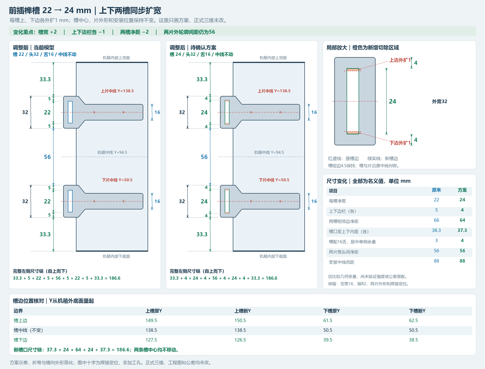
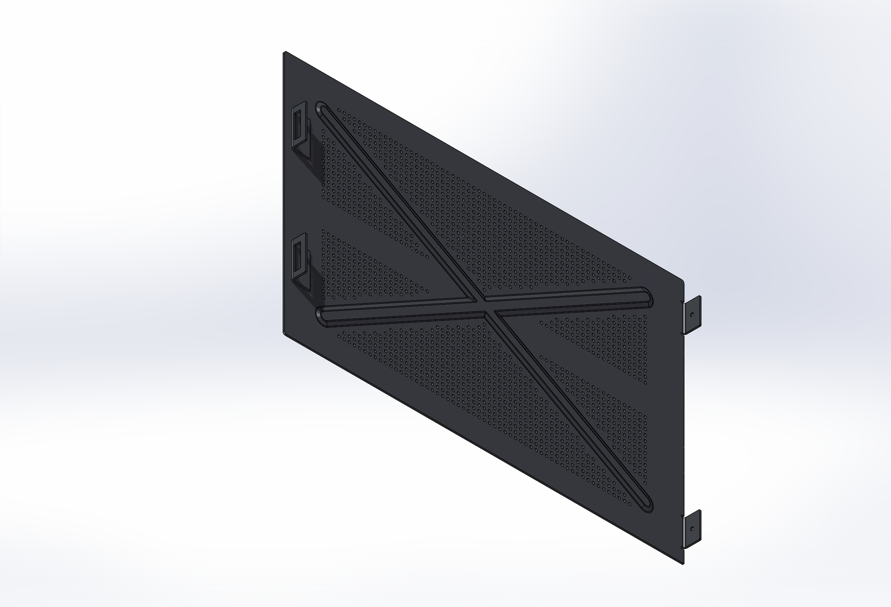

# 设计过程与确认决策

本页整理已讨论的结构选择及最终采用方案。历史过程中出现过螺纹版、铆接版和多次尺寸候选；仓库只保存当前焊接版的实体文件。

## 相同单箱的连接

两个同样的单箱沿X方向相对平移71.2 mm组合。早期安装片孔位与背板孔位的边距分别为4.5和6 mm，组合时无法重合，因此采用保留背板6 mm、调整安装片的方向。

当前后挡片外伸M3孔中心X=-6；另一个箱体背板孔中心X=65.2。组合后的名义关系为：

```text
-6 + 71.2 = 65.2 mm
```

后孔上下中心Y20.5 / 163.5，中心距143 mm。后安装挡片只焊到自身箱体，不把相邻两个箱体焊成一体。

## 前插榫与槽口

早期用户要求以整数、偶数和对称结构为优先，同时保持舌片与槽之间的装配余量。经过宽头、舌宽、两片间距和位置的多轮示意，最终保留头宽32、舌宽16、舌端R2、上下中线Y50.5 / 138.5。下片安装位置向下移动1 mm的方案因干涉被撤回，不属于当前设计。

最近一次批准改动是把两片前插榫**自身长槽**从22改为24 mm。每槽上、下边各外扩1 mm，槽中线和片外轮廓不变：

| 项目 | 修订前 | 当前 |
| --- | ---: | ---: |
| 每槽净宽 | 22 | 24 |
| 上下边栏各 | 5 | 4 |
| 两槽相邻边净距 | 66 | 64 |
| 槽到上下内部平面距离各 | 38.3 | 37.3 |
| 槽24配16舌，居中单侧几何余量 | 3 | 4 |
| 两片宽头间净距 | 56 | 56 |
| 两片窄舌间净距 | 72 | 72 |
| 安装中线中心距 | 88 | 88 |

单位均为mm。“居中单侧几何余量”只表示名义尺寸之差，不表示已经验证公差极限、喷涂厚度、装入路径和受力。



这张图保存的是**批准前的方案示意**，图内仍有“正式三维未改”等当时说明。用户随后已批准，CAD与工程图中的相应槽尺寸已修改；当前模型以生产目录文件为准。该图用于解释前后差异，不能代替生产工程图。

## 焊接版的连接分工

| 位置 | 当前连接方式 | 说明 |
| --- | --- | --- |
| 前插榫与前面板 | 每片2点电阻点焊 | 每单箱4点；窄舌自由端不焊 |
| 后安装挡片与本机背板 | 每片上下边各一段8 mm激光搭接焊 | 每单箱4段；只焊本机箱一侧 |
| 侧板前L卡耳与侧盖板 | 独立卡耳点焊 | 保留原前卡耳结构 |
| 侧板后M3安装耳 | 与侧盖板同料一体90°折弯 | 不作为独立焊接零件 |
| 侧板与箱体后部、双箱组合 | M3螺纹连接接口 | 螺钉规格和装配工艺仍需补充验证 |

用户曾研究把侧板前卡耳也做成一体折弯。回折复杂、外观和一次折弯方案均未最终采用，最后决定保持原前卡耳结构。因此当前侧板总成仍由一体侧盖板1件、前L卡耳2件组成。

## 侧盖板覆盖与加强

侧板位于前插榫舌片一侧，覆盖机箱侧面，前部以18 × 5 mm卡耳槽与16 mm窄舌配合，后部用M3接口固定。后孔至内贴合面的距离由8调整为6 mm，孔型按M3×0.5-6H保留。

为兼顾大面积散热和抗变形，比较过多道直线压筋等形式，最后采用X形浅压印，压深由2 mm减为1 mm。中线保留连续无孔横带，网孔避让斜筋。



该截图来自2026-11-05的查看记录，便于识别结构；现有文件名以[文件指南](file-guide.md)为准。

## 后耳折弯和背板避让

后M3安装耳采用一体折弯，需要给圆弧留出空间。用户允许在背板对应上下位置增加局部避让，采用两处2 × 24 mm缺口、内角R0.5。

之后曾讨论去掉看起来凹进去的缺口，但会影响圆弧避让和其他关系，最终决定**保留这两处避让缺口及后耳结构**。它们不是待取消的装饰凹坑。

## 可编辑性与文件收口

全部零件保留原生草图与实体特征。修改采用逐个零件、重建相关装配和关闭临时工程图的方式，避免同时加载多个历史版本。

最终只保留焊接版。所有生产用文件集中到一个目录，侧板子目录与主装配一起交付；重复ZIP已从生产位置移除。旧版尺寸、旧孔型和未采用的折弯候选不作为当前制造依据。
